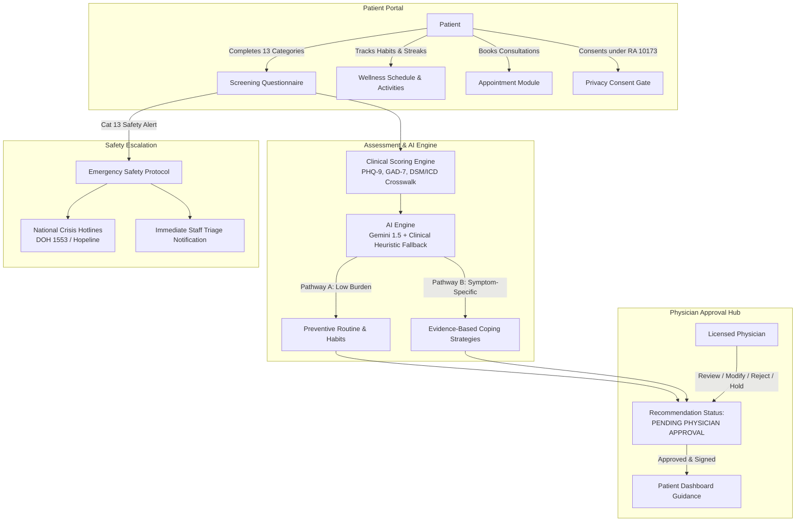

# GabAI
### An AI-Driven Platform for Mental Health Monitoring and Personalized Recommendation System

[](https://www.djangoproject.com/)
[](https://mariadb.org/)
[](https://getbootstrap.com/)
[](https://www.chartjs.org/)
[-blue)](https://www.privacy.gov.ph/)

---

## 1. Executive Summary

**GabAI** is an enterprise-grade, ethically bounded, physician-supervised mental health assessment and wellness management platform. Designed specifically to bridge the gap between initial psychological screening and qualified professional psychiatric care, GabAI utilizes advanced Large Language Models (LLMs) and deterministic clinical scoring to identify psychological concerns, structure personalized daily wellness programs, and streamline clinical triage.

### Core Ethical & Clinical Safety Guardrails
- **AI Decision Support Only**: AI *never* independently diagnoses patients, determines clinical treatment plans, or prescribes pharmaceuticals.
- **Mandatory Physician Gatekeeper**: Every AI-generated recommendation begins with the status `PENDING PHYSICIAN APPROVAL`. Recommendations are strictly quarantined from patients until a licensed physician approves or modifies them.
- **Immediate Crisis Protocol (Category 13)**: Any reported self-harm ideation or safety concerns immediately trigger a high-priority emergency protocol, routing the patient to 24/7 crisis hotlines (Philippine DOH 1553, Hopeline) and notifying clinical staff.
- **Philippine Data Privacy Act (RA 10173)**: Built-in explicit consent collection, patient profile de-identification, and role-based access control (RBAC).

---

## 2. System Architecture



---

## 3. Technology Stack

- **Backend**: Python 3.12, Django 5.2 (with custom MariaDB 10.4 compatibility layer)
- **Database**: MySQL / MariaDB (XAMPP-compatible, running on port 3307 or 3306)
- **AI Integration**: Google Gemini 1.5 Flash (`google-generativeai`) with a dual-mode Clinical Heuristic Fallback Engine
- **Frontend**: HTML5, CSS3, JavaScript (ES6+), Bootstrap 5.3, Font Awesome 6.5
- **Data Visualization**: Chart.js 4.4 (13-category radar charts, activity completion doughnut charts, clinical analytics)
- **Security & Privacy**: PBKDF2 password hashing, CSRF protection, secure cookie handling, strict RBAC middleware, full tamper-evident audit logging

---

## 4. Key Functional Modules

### 1. 13-Category Mental Health Screening Questionnaire
Covers official standardized rating scales and clinical domains:
1. **Anxiety** (GAD-7 standard scale)
2. **Depression** (PHQ-9 standard scale)
3. **Stress** (Perceived stress and burnout)
4. **ADHD-Related Symptoms** (Attention, hyperactivity, executive function)
5. **Bipolar-Related Symptoms** (Mood cycling, hypomanic episodes)
6. **OCD-Related Symptoms** (Intrusive thoughts, compulsive behaviors)
7. **PTSD-Related Symptoms** (Trauma recall, hypervigilance)
8. **Autism-Related Developmental Traits** (Sensory processing, routine preference)
9. **Sleep-Related Concerns** (Insomnia, sleep hygiene)
10. **Eating-Related Concerns** (Appetite dysregulation, body image)
11. **Psychosis-Related Experiences** (Perceptual disturbances)
12. **Substance Use Concerns** (Frequency, dependence markers)
13. **Personal Safety Assessment (CRITICAL)** (Self-harm ideation, immediate crisis triage)

### 2. Dual-Pathway AI Recommendation Engine
- **Pathway A (Preventive Wellness)**: For patients with minimal symptom burden. Generates personalized morning-to-night daily schedules (mindfulness, circadian hygiene, focused work breaks, physical exercise) and weekly milestones.
- **Pathway B (Symptom-Specific Coping)**: For patients with elevated screening indicators. Generates evidence-based coping strategies tailored to reported concerns (e.g., box breathing for anxiety, behavioral activation for depression, task chunking for ADHD) and reinforces professional psychiatric consultation.

### 3. Physician Review & Approval Dashboard
Physicians have complete clinical oversight:
- **Approve**: Releases AI recommendation to patient dashboard.
- **Modify**: Allows inline editing of daily routines, weekly activities, and clinical notes before release.
- **Reject**: Rejects recommendation with mandatory clinical justification; requests AI regeneration.
- **Request Further Assessment**: Places recommendation on hold and schedules clinical interview.
- **Version Control**: Every modification preserves the original AI draft, physician diff, timestamp, and physician digital signature.

### 4. Interactive Wellness Scheduler
- Hourly timeline with one-click **Complete**, **Skip**, or **Reschedule** actions.
- Real-time Chart.js doughnut tracker showing completion percentage.
- 14-day habit streak calculator.
- Weekly milestone tracking.

### 5. Emergency Crisis & Safety Triage
- Immediate banner warning upon Category 13 trigger.
- Dedicated `/safety/crisis/` emergency page with 1-tap dial buttons for Philippine crisis hotlines:
  - **National Mental Health Crisis Hotline**: `1553` (Luzon/Visayas/Mindanao toll-free)
  - **Hopeline Philippines**: `0917-558-4673` / `(02) 8804-4673`
  - **In Touch Crisis Line**: `0917-800-1123`
- Clinical emergency dashboard for immediate case escalation and physician contact logging.

### 6. Clinical Reports & Analytics
- Formal printable **Clinical Screening Report** with printable styling (`@media print` / Save as PDF).
- **Physician-Approved Recommendation Audit Report**.
- Population-level **Clinical Analytics Dashboard** with elevated category percentages.
- System-wide **Audit Log Viewer** for administrative oversight.

---

## 5. Seed Data & Demo Accounts

The database comes pre-seeded with 6 accounts and 4 representative clinical cases:

| Role | Username | Password | Purpose & Notes |
| :--- | :--- | :--- | :--- |
| **Administrator** | `admin` | `AdminPass123!` | System configuration, audit logs, user management |
| **Attending Psychiatrist** | `dr.santos` | `DoctorPass123!` | Adult Psychiatry & Clinical Review Board |
| **Clinical Psychologist** | `dr.reyes` | `DoctorPass123!` | Neurodevelopmental & Adolescent Psychology |
| **Healthcare Staff** | `staff.maria` | `StaffPass123!` | Patient intake, triage, and appointment booking |
| **Patient (Preventive)** | `patient.juan` | `PatientPass123!` | Minimal screening burden; approved Pathway A daily routine |
| **Patient (Clinical)** | `patient.ana` | `PatientPass123!` | Elevated GAD-7 & PHQ-9; physician-approved Pathway B care |
| **Patient (Pending)** | `patient.carlos` | `PatientPass123!` | Elevated ADHD symptoms; recommendation pending review |
| **Patient (Emergency)** | `patient.elena` | `PatientPass123!` | Safety Category 13 triggered; active crisis triage protocol |

---

## 6. Installation & Quickstart

### Prerequisites
1. Python 3.10+ (Python 3.12 recommended)
2. MySQL or MariaDB (via XAMPP or standalone server)
3. Virtual environment (optional but recommended)

### Step 1: Clone or Navigate to the Workspace
```powershell
cd c:\Users\Administrator\Desktop\Hackathon
```

### Step 2: Install Python Dependencies
```powershell
pip install -r requirements.txt
```

### Step 3: Configure Database & Environment
Copy or edit `.env` in the project root:
```env
DEBUG=True
SECRET_KEY=mindcare-ai-super-secret-production-grade-key-2026
MYSQL_DATABASE=mindcare_ai
MYSQL_USER=root
MYSQL_PASSWORD=
MYSQL_HOST=127.0.0.1
MYSQL_PORT=3307
GEMINI_API_KEY=your_gemini_api_key_here  # Optional: falls back to clinical heuristic engine
```

### Step 4: Apply Database Migrations & Seed Data
```powershell
python manage.py migrate
python seed_data.py
```

### Step 5: Run the Verification Test Suite
```powershell
python tests_comprehensive.py
```
*Expected: 13/13 tests pass (User models, 13 categories, scoring engine, AI safety quarantine, physician approval, wellness tracking, cross-patient isolation).*

### Step 6: Start the Development Server
```powershell
python manage.py runserver 0.0.0.0:8000
```
Open your browser and navigate to: **`http://localhost:8000/`**

---

## 7. Compliance & Data Privacy Statement

GabAI is designed in adherence with:
- **Republic Act No. 10173** (Philippine Data Privacy Act of 2012)
- **Republic Act No. 11036** (Philippine Mental Health Act)
- **WHO Guidance on Ethics & Governance of AI for Health**

All patient questionnaires require explicit prior informed consent. De-identification is enforced across clinical analytics, and all diagnostic determinations remain the exclusive prerogative of board-certified medical professionals.

---

## 8. Authors & Acknowledgments

Developed for the Mental Health Hackathon 2026.
Designed with patient dignity, clinician ergonomics, and safety-first artificial intelligence at its core.
